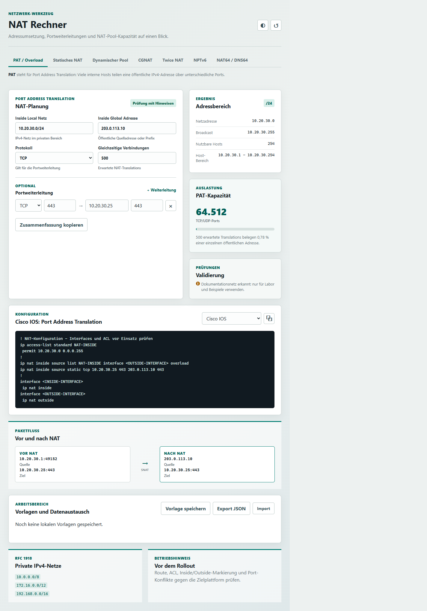

# NAT Rechner

Ein lokaler, abhängigkeitsfreier Rechner für IPv4- und IPv6-NAT-Planung. Das Tool hilft bei der Auslegung von NAT-Regeln, prüft typische Adresskonflikte und erzeugt Konfigurationsvorlagen für mehrere Plattformen.



*PAT-Planung mit Echtzeit-Validierung, Cisco-IOS-Vorlage und visualisiertem Paketfluss.*

## Funktionen

- CIDR-Auswertung für IPv4-Netze mit Netzadresse, Broadcast, Hostbereich und nutzbaren Hosts
- PAT / NAT Overload mit Portkapazität und erwarteter Auslastung
- Statisches NAT als $1:1$-Zuordnung
- Dynamische NAT-Pools mit Berechnung der verfügbaren öffentlichen Adressen
- CGNAT mit RFC-6598-Validierung, Portblock-Größe und Abonnentenkapazität
- Twice NAT für gleichzeitige Quell- und Zielübersetzung bei überlappenden Netzen
- NPTv6 für IPv6-Präfixübersetzung sowie NAT64/DNS64 mit $/96$-Präfixprüfung
- Beliebig viele TCP- und UDP-Portweiterleitungen
- Echtzeit-Validierung von IPv4-/IPv6-Adressen, CIDR-Präfixen, Portnummern und doppelten Weiterleitungen
- Warnungen für RFC-1918-/RFC-6598-Verstöße, Loopback, Multicast, Dokumentationsnetze, Pool- und Netzüberlappungen sowie Port-Erschöpfung
- Visueller Paketfluss vor und nach NAT für SNAT, DNAT, Twice NAT, NPTv6 und NAT64
- Kopierbare Zusammenfassung und Konfigurationsvorlagen für Cisco IOS, Cisco ASA/Firepower, Juniper Junos, Fortinet FortiGate, Linux `iptables` und `nftables`
- Lokale Vorlagen für wiederkehrende Wartungsfenster
- JSON-Export sowie JSON- und CSV-Import für Bulk-Regeln
- Hinweis auf RFC-1918-Adressbereiche und relevante Prüfschritte vor dem Rollout
- Umschaltbarer Dark Mode; die Auswahl bleibt lokal im Browser gespeichert
- Responsive Darstellung für Desktop und Mobilgeräte

## Verwendung

Die Anwendung besteht nur aus statischen Dateien und benötigt weder einen Build-Schritt noch einen Server. [index.html](index.html) kann direkt im Browser geöffnet werden.

1. Inside-Local-Netz im CIDR-Format eingeben, beispielsweise `10.20.30.0/24`.
2. Öffentliche Adresse sowie erwartete Anzahl gleichzeitiger Translations festlegen.
3. Den NAT-Modus auswählen und bei Bedarf Pool- oder statische Zuordnung eintragen.
4. Optionale Portweiterleitungen hinzufügen.
5. Die berechnete Zusammenfassung oder IOS-Konfiguration kopieren und vor dem Einsatz Interfaces, Routing und Firewall-Regeln an die Zielumgebung anpassen.

## NAT-Modi

| Modus | Zweck | Berechnung |
| --- | --- | --- |
| PAT / Overload | Viele private Hosts teilen eine öffentliche Adresse. | Bis zu 64.512 TCP-/UDP-Ports pro öffentlicher IP-Adresse. |
| Statisches NAT | Ein privater Host bekommt dauerhaft eine feste öffentliche Adresse. | Eine $1:1$-Zuordnung. |
| Dynamischer Pool | Private Hosts erhalten bei Bedarf Adressen aus einem öffentlichen Pool. | Anzahl der Adressen zwischen Pool-Anfang und Pool-Ende. |
| CGNAT | Viele Abonnenten teilen öffentliche Adressen mit festen Portblöcken. | Poolgröße multipliziert mit verfügbaren Portblöcken pro Adresse. |
| Twice NAT | Quelle und Ziel werden in derselben Regel übersetzt. | Gleich große Quell- und Zielnetze für symmetrische Zuordnung. |
| NPTv6 | IPv6-Präfix wird ohne Portübersetzung ersetzt. | Innen- und Außenpräfix benötigen dieselbe Länge. |
| NAT64 / DNS64 | IPv6-Clients erreichen IPv4-Ziele. | NAT64-Präfix mit Länge $/96$ und eingebettete IPv4-Zieladresse. |

Die IOS-Ausgabe ist eine Vorlage. Interface-Namen, Access-Listen, Routing, Sicherheitsregeln und die plattformspezifische Syntax müssen vor einem produktiven Einsatz geprüft werden.

## Bulk-Import

Der JSON-Export kann später wieder importiert werden und enthält die aktuelle Planung sowie gespeicherte Vorlagen. Für eine Massenliste statischer NAT-Zuordnungen akzeptiert der Import auch CSV-Dateien mit mindestens diesen Spalten:

```csv
private_ip,public_ip
10.20.30.10,198.51.100.10
10.20.30.11,198.51.100.11
```

Gültige CSV-Zeilen erscheinen als zusätzliche Cisco-IOS-Bulk-Regeln in der Konfigurationsausgabe.

## Als Lesezeichen-Hub-Modul einbinden

1. Im Lesezeichen-Hub **Hinzufügen > Lokales Modul** öffnen.
2. Eine vorhandene Gruppe auswählen oder zuerst eine anlegen.
3. Als lokalen Ordner den Ordner dieses Repositories auswählen.
4. Das Modul speichern; der Hub stellt [index.html](index.html) dann unter seiner Modul-URL bereit.

Da alle Dateien relativ eingebunden sind, funktioniert das Modul sowohl direkt aus dem Dateisystem als auch innerhalb des Lesezeichen-Hubs.

## Dateien

- [index.html](index.html): Struktur und Bedienoberfläche
- [app.js](app.js): IPv4-, NAT- und Konfigurationslogik
- [styles.css](styles.css): responsives Layout und helle/dunkle Oberfläche